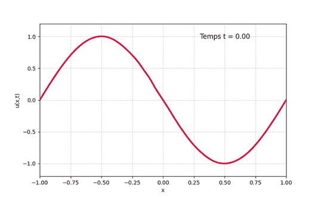
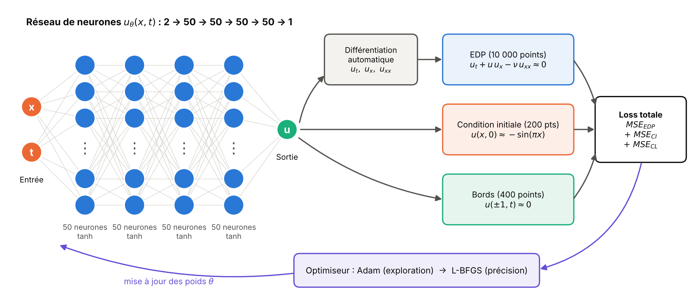
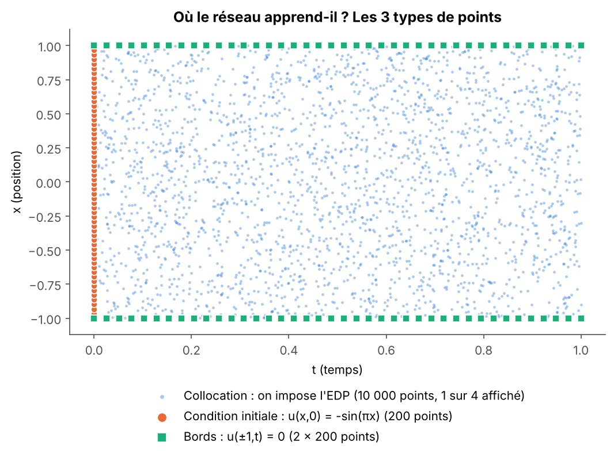
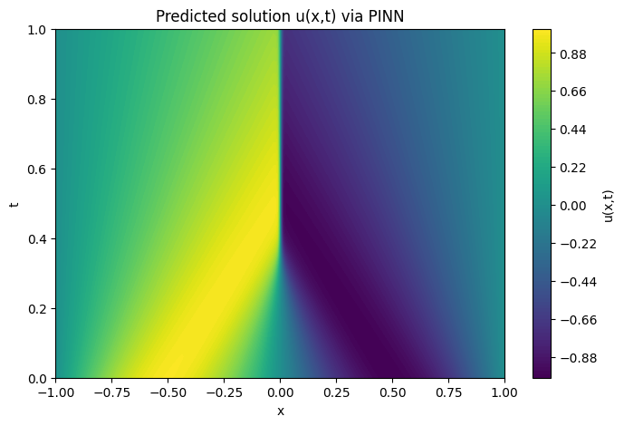
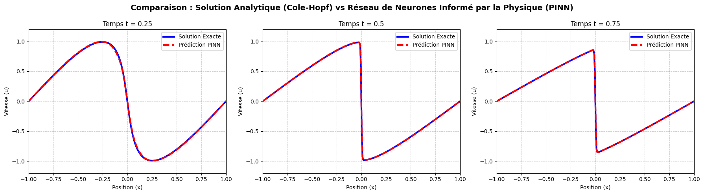
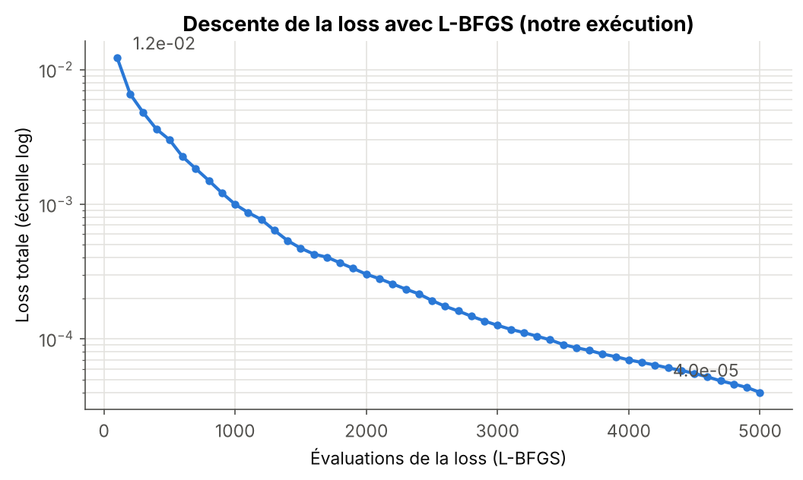
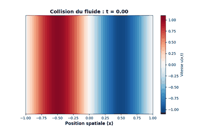

# PINN : résoudre l'équation de Burgers avec un réseau de neurones


Projet personnel. J'entraîne un **réseau de neurones informé par la physique** (PINN, *Physics-Informed Neural Network*) pour résoudre l'**équation de Burgers**, une équation aux dérivées partielles (EDP) classique en mécanique des fluides.

**En bref :**

- Le réseau reçoit une position `x` et un temps `t`, et renvoie la vitesse du fluide `u(x, t)`.
- Il n'apprend **aucune solution toute faite** : la seule chose qu'on lui demande, c'est de respecter l'équation, la condition initiale et les conditions aux bords.
- On l'entraîne avec deux optimiseurs à la suite : **Adam** pour démarrer, puis **L-BFGS** pour la précision.
- Résultat : **erreur relative de 0,45 %** par rapport à la solution exacte, y compris autour du choc.

<p align="center">
  
  <br><em>La vitesse u(x, t) prédite par le PINN : les deux moitiés du fluide se rencontrent en x = 0 et forment un choc.</em>
</p>

---

## Sommaire

1. [Le problème : l'équation de Burgers](#1-le-problème--léquation-de-burgers)
2. [L'idée d'un PINN](#2-lidée-dun-pinn)
3. [Les contraintes de l'EDP, une par une](#3-les-contraintes-de-ledp-une-par-une)
4. [Comment le réseau calcule ses propres dérivées](#4-comment-le-réseau-calcule-ses-propres-dérivées)
5. [Architecture du réseau](#5-architecture-du-réseau)
6. [Les optimiseurs : pourquoi Adam puis L-BFGS ?](#6-les-optimiseurs--pourquoi-adam-puis-l-bfgs-)
7. [Vérification avec la solution exacte](#7-vérification-avec-la-solution-exacte)
8. [Résultats](#8-résultats)
9. [Lancer le code](#9-lancer-le-code)
10. [Limites et pistes d'amélioration](#10-limites-et-pistes-damélioration)

---

## 1. Le problème : l'équation de Burgers

On cherche une fonction `u(x, t)` (la vitesse d'un fluide) qui vérifie :

```math
\frac{\partial u}{\partial t} + u\,\frac{\partial u}{\partial x} = \nu\,\frac{\partial^2 u}{\partial x^2},
\qquad x \in [-1, 1],\quad t \in [0, 1],\quad \nu = \frac{0.01}{\pi}
```

Chaque terme a un sens physique simple :

| Terme | Nom | Ce qu'il fait |
|---|---|---|
| $u_t$ | variation dans le temps | comment la vitesse change à un endroit donné |
| $u\,u_x$ | convection (non linéaire) | le fluide se transporte lui-même : les zones rapides rattrapent les zones lentes |
| $\nu\,u_{xx}$ | viscosité (diffusion) | lisse la solution, comme un frottement |

Avec en plus :

- **Condition initiale** (à t = 0) : $u(x, 0) = -\sin(\pi x)$
- **Conditions aux limites** (aux deux bords) : $u(-1, t) = u(1, t) = 0$

**Pourquoi c'est difficile ?** Au départ, le fluide à gauche (x < 0) va vers la droite et celui de droite va vers la gauche. Ils se rencontrent en x = 0. Comme la viscosité ν est **très petite**, rien n'empêche la pente de devenir presque verticale : un **choc** se forme vers t ≈ 1/π ≈ 0,32. Un réseau de neurones doit donc apprendre une fonction lisse presque partout, mais presque discontinue au milieu.

## 2. L'idée d'un PINN

Les méthodes classiques (différences finies, volumes finis…) découpent l'espace et le temps en une grille et calculent `u` sur chaque case.

Un PINN fait autrement : **le réseau de neurones est lui-même la solution**. C'est une fonction $u_\theta(x, t)$ dont les paramètres θ (poids et biais) sont ajustés pour que :

1. l'équation soit vérifiée partout dans le domaine,
2. la condition initiale soit respectée,
3. les conditions aux bords soient respectées.

<p align="center">
  
</p>

Pas besoin de maillage, et on obtient une fonction **continue** qu'on peut évaluer en n'importe quel point (x, t).

## 3. Les contraintes de l'EDP, une par une

On choisit trois familles de points, et sur chacune on mesure « à quel point le réseau se trompe ».

<p align="center">
  
</p>

| Contrainte | Où ? | Nombre de points | Ce qu'on veut | Erreur mesurée |
|---|---|---|---|---|
| **EDP** | partout dans le domaine, tirés au hasard | 10 000 | $f = u_t + u\,u_x - \nu\,u_{xx} = 0$ | $MSE_{EDP} = \frac{1}{N_f}\sum f(x_i, t_i)^2$ |
| **Condition initiale** | sur la ligne t = 0 | 200 | $u(x, 0) = -\sin(\pi x)$ | $MSE_{CI} = \frac{1}{N_0}\sum \big(u(x_i,0) + \sin(\pi x_i)\big)^2$ |
| **Conditions aux limites** | sur x = −1 et x = 1 | 2 × 200 | $u(\pm 1, t) = 0$ | $MSE_{CL} = \frac{1}{N_b}\sum u(\pm 1, t_i)^2$ |

La fonction à minimiser (la *loss*) est simplement la somme des trois :

```math
\mathcal{L}(\theta) = MSE_{EDP} + MSE_{CI} + MSE_{CL}
```

Si la loss vaut 0, le réseau respecte **exactement** l'équation et toutes les conditions : c'est la solution du problème.

En code, c'est presque une traduction mot à mot :

```python
def calcul_loss(model):
    loss_edp = torch.mean(residu_edp(model, x_f, t_f) ** 2)   # l'équation
    loss_ci  = torch.mean((model(x_0, t_0) - u_0) ** 2)       # t = 0
    loss_cl  = torch.mean((model(x_b, t_b) - u_b) ** 2)       # bords
    return loss_edp + loss_ci + loss_cl
```

> **Contraintes « molles » ou « dures » ?** Ici les conditions sont imposées de façon **molle** : elles sont dans la loss, donc respectées *approximativement* (à 10⁻⁵ près à la fin). Une variante consiste à les imposer de façon **dure**, directement dans la forme de la solution :
>
> ```python
> u = -torch.sin(np.pi * x) + t * (1 - x**2) * model(x, t)
> ```
>
> À t = 0 on retrouve exactement −sin(πx), et en x = ±1 on a exactement 0, quel que soit le réseau. Il ne reste alors que l'EDP dans la loss. C'est une piste d'amélioration (voir la fin).

## 4. Comment le réseau calcule ses propres dérivées

Pour évaluer l'EDP, il faut $u_t$, $u_x$ et $u_{xx}$. On ne les approche **pas** par différences finies : on utilise la **différentiation automatique** de PyTorch. Le réseau est une composition de fonctions simples (multiplications, additions, tanh), donc PyTorch sait calculer ses dérivées **exactes** avec la règle de dérivation en chaîne.

```python
def derivee(sortie, entree):
    return torch.autograd.grad(sortie, entree,
                               grad_outputs=torch.ones_like(sortie),
                               create_graph=True)[0]

def residu_edp(model, x, t):
    u    = model(x, t)
    u_t  = derivee(u, t)
    u_x  = derivee(u, x)
    u_xx = derivee(u_x, x)        # on dérive une 2e fois
    return u_t + u * u_x - NU * u_xx
```

Deux détails importants :

- `requires_grad=True` sur les points `x_f` et `t_f` : sinon PyTorch ne garde pas la trace de la dépendance de u par rapport à x et t.
- `create_graph=True` : garde le calcul de la dérivée en mémoire, pour pouvoir **re-dériver** (obtenir $u_{xx}$) et pour que l'optimiseur puisse ensuite calculer le gradient de la loss par rapport aux poids.

## 5. Architecture du réseau

| Choix | Valeur | Pourquoi |
|---|---|---|
| Entrées | 2 : (x, t) | la solution dépend de la position et du temps |
| Couches cachées | 4 couches de 50 neurones | assez de capacité pour représenter le choc, tout en restant rapide |
| Activation | **tanh** | lisse et dérivable autant de fois qu'on veut. Avec ReLU, la dérivée seconde vaut 0 presque partout : le terme $\nu\,u_{xx}$ disparaîtrait ! |
| Sortie | 1 : u(x, t), sans activation | la vitesse peut être positive ou négative |
| Initialisation | Xavier | adaptée à tanh : les signaux ne s'éteignent pas et n'explosent pas au début |
| Paramètres | 7 851 | (2×50+50) + 3×(50×50+50) + (50+1) |

## 6. Les optimiseurs : pourquoi Adam puis L-BFGS ?

Entraîner le réseau, c'est trouver les 7 851 paramètres θ qui rendent la loss la plus petite possible. Un optimiseur est la règle qui dit « comment modifier θ à chaque étape ». On en utilise **deux, l'un après l'autre**, parce qu'ils sont bons à des moments différents.

### Adam : le randonneur prudent (phase 1)

La descente de gradient de base fait : $\theta \leftarrow \theta - \eta\,\nabla\mathcal{L}(\theta)$ (on descend dans la direction de la plus forte pente, avec un pas η).

Adam ajoute deux idées :

1. **L'élan (momentum)** : il fait la moyenne des gradients récents. Ça lisse les zigzags, comme une bille qui garde de l'élan.
2. **Un pas adapté à chaque paramètre** : il divise par la taille moyenne des gradients de chaque poids. Un poids dont le gradient est énorme fait des petits pas, un poids dont le gradient est minuscule fait des pas plus grands.

<details>
<summary>Les formules d'Adam (pour ceux qui veulent)</summary>

À l'étape k, avec le gradient $g_k = \nabla\mathcal{L}(\theta_k)$ :

```math
m_k = \beta_1 m_{k-1} + (1-\beta_1)\,g_k \qquad v_k = \beta_2 v_{k-1} + (1-\beta_2)\,g_k^2
```
```math
\theta_{k+1} = \theta_k - \eta\,\frac{\hat m_k}{\sqrt{\hat v_k} + \varepsilon}
```

avec $\hat m_k, \hat v_k$ les versions corrigées du biais de départ, $\beta_1 = 0.9$, $\beta_2 = 0.999$ et ici $\eta = 10^{-3}$.
</details>

**Pourquoi au début ?** Les poids sont aléatoires, la loss est un paysage accidenté. Adam est **robuste** : il avance régulièrement sans diverger. **Sa limite** : avec un pas fixe, il finit par « tourner autour » du minimum sans y descendre vraiment. La loss stagne.

### L-BFGS : le skieur qui lit la pente (phase 2)

La méthode de Newton est bien plus rapide près d'un minimum : elle utilise la **courbure** de la loss (la matrice hessienne H, les dérivées secondes) pour choisir un pas intelligent : grand là où c'est plat, petit là où ça tourne fort :

```math
\theta \leftarrow \theta - H^{-1}\,\nabla\mathcal{L}(\theta)
```

Problème : avec 7 851 paramètres, H a 7 851² ≈ **62 millions** de cases, c'est trop cher à calculer et à inverser.

**L-BFGS** (*Limited-memory BFGS*) contourne le problème : il **devine** la courbure en regardant comment le gradient a changé lors des derniers pas. Il ne garde en mémoire que les `history_size = 50` derniers déplacements, ce qui est très léger.

À chaque itération, une **recherche linéaire** (*strong Wolfe*) teste plusieurs longueurs de pas et garde celle qui fait vraiment baisser la loss. C'est pour ça que :

- L-BFGS a besoin d'une fonction `closure()` qui recalcule la loss (il l'appelle plusieurs fois par itération) ;
- on peut mettre `lr=1.0` : ce n'est qu'un premier essai, la recherche linéaire ajuste.

```python
optimizer_lbfgs = torch.optim.LBFGS(model.parameters(), lr=1.0,
                                    max_iter=5000, history_size=50,
                                    line_search_fn="strong_wolfe")

def closure():
    optimizer_lbfgs.zero_grad()
    loss, _ = calcul_loss(model)
    loss.backward()
    return loss

optimizer_lbfgs.step(closure)
```

**Pourquoi à la fin ?** Notre loss est **déterministe** (toujours les mêmes 10 600 points, pas de mini-batch) : c'est exactement le cadre où L-BFGS excelle. Près du minimum, il converge beaucoup plus vite et plus précisément qu'Adam. **Sa limite** : au tout début, avec des poids aléatoires, son estimation de la courbure est mauvaise et il peut se bloquer ou devenir instable.

### Le duo en résumé

| | Adam | L-BFGS |
|---|---|---|
| Type | 1er ordre (gradient seul) | quasi-Newton (gradient + courbure estimée) |
| Coût d'une itération | 1 calcul de gradient | plusieurs (recherche linéaire) |
| Réglage | taux d'apprentissage η à choisir | presque rien à régler |
| Point fort | robuste quand on part de loin | très précis près du minimum |
| Point faible | stagne près du minimum | fragile au départ, n'aime pas le bruit |
| **Rôle ici** | **amener le réseau dans la bonne vallée** | **descendre jusqu'au fond** |

C'est la stratégie classique dans la littérature sur les PINNs : Adam pour l'exploration, L-BFGS pour la précision.

### Paramètres de L-BFGS utilisés

| Paramètre | Valeur | Rôle |
|---|---|---|
| `lr` | 1.0 | longueur du premier pas testé (ajustée ensuite par la recherche linéaire) |
| `max_iter` / `max_eval` | 5 000 | budget maximum d'itérations / d'évaluations de la loss |
| `history_size` | 50 | nombre de pas passés utilisés pour estimer la courbure |
| `tolerance_grad` | 1e-5 | arrêt si le gradient devient minuscule |
| `tolerance_change` | 1e-9 | arrêt si la loss ne bouge plus |
| `line_search_fn` | `"strong_wolfe"` | garantit que chaque pas fait vraiment baisser la loss : indispensable pour la stabilité |

## 7. Vérification avec la solution exacte

L'équation de Burgers a un avantage rare : on connaît sa **solution exacte**. La **transformation de Cole-Hopf** ($u = -2\nu\,\varphi_x / \varphi$) la transforme en équation de la chaleur, qu'on sait résoudre. On obtient une formule intégrale :

```math
u(x,t) = \frac{\displaystyle\int \frac{x-y}{t}\, e^{-G(y)/2\nu}\,dy}{\displaystyle\int e^{-G(y)/2\nu}\,dy},
\qquad G(y) = \frac{\cos(\pi y) - 1}{\pi} + \frac{(x-y)^2}{2t}
```

On calcule ces intégrales numériquement (fonction `solution_exacte` dans le code, avec une astuce pour éviter que l'exponentielle ne dépasse la capacité des nombres flottants). On compare ensuite le PINN à cette référence avec l'**erreur relative L2** :

```math
\text{erreur} = \frac{\lVert u_{exacte} - u_{PINN} \rVert_2}{\lVert u_{exacte} \rVert_2}
```

## 8. Résultats

Résultats de mon exécution sur Google Colab (version notebook, L-BFGS, 5 000 évaluations) :

| Indicateur | Valeur |
|---|---|
| Loss finale | 4,0 × 10⁻⁵ |
| Erreur relative L2 (sur une grille 256 × 100) | **4,5 × 10⁻³** (soit 0,45 %) |

**La solution dans tout le domaine** : on voit les deux zones (u > 0 à gauche, u < 0 à droite) qui se rejoignent, et la ligne verticale du choc en x = 0 à partir de t ≈ 0,3.

<p align="center"></p>

**Comparaison avec la solution exacte** à trois instants : les courbes se superposent, même dans le choc.

<p align="center"></p>

**La descente de la loss** pendant L-BFGS : elle est divisée par plus de 300.

<p align="center"></p>

**Vue « tube de fluide »** : rouge = le fluide va vers la droite, bleu = vers la gauche. Le choc apparaît comme une frontière nette au milieu.

<p align="center"></p>

## 9. Lancer le code

**Sur Google Colab (recommandé, GPU gratuit)** : ouvrir `pinn_burgers.ipynb` dans Colab, puis *Exécution → Tout exécuter*.

**En local :**

```bash
git clone https://github.com/issa230/pinn-equation-burgers.git
cd pinn-equation-burgers
pip install -r requirements.txt
python pinn_burgers.py
```

Le script entraîne le réseau (2 000 itérations d'Adam puis L-BFGS), affiche l'erreur L2 et enregistre les figures dans `figures/` (`solution_pinn.png`, `comparaison_exacte.png`, `loss.png`, `burgers_animation.gif`). Sur CPU, compter plusieurs dizaines de minutes ; sur GPU, quelques minutes. Les chiffres peuvent varier légèrement d'une machine à l'autre.

### Structure du dépôt

```
pinn-equation-burgers/
├── pinn_burgers.py        # le code complet, commenté section par section
├── pinn_burgers.ipynb     # la même chose en notebook (pour Colab)
├── requirements.txt
└── figures/               # figures du README et figures générées par le script
```

## 10. Limites et pistes d'amélioration

- **Le choc reste la zone difficile.** Les points de collocation sont répartis uniformément, alors que l'erreur se concentre en x = 0. Piste : ajouter des points là où le résidu est grand (*échantillonnage adaptatif*).
- **Équilibrer les trois termes de la loss.** Ici ils ont le même poids. On peut leur donner des poids différents, voire les adapter pendant l'entraînement.
- **Contraintes dures** (voir section 3) : supprimer deux termes de la loss en imposant CI et CL directement dans la forme de la solution.
- **Problème inverse** : retrouver la viscosité ν à partir de quelques mesures de u, en faisant de ν un paramètre appris. C'est un des grands atouts des PINNs.

## Références

- M. Raissi, P. Perdikaris, G. E. Karniadakis (2019). *Physics-informed neural networks: A deep learning framework for solving forward and inverse problems involving nonlinear partial differential equations.* Journal of Computational Physics, 378, 686–707.
- C. Basdevant et al. (1986). *Spectral and finite difference solutions of the Burgers equation.* Computers & Fluids, 14(1), 23–41.
- D. P. Kingma, J. Ba (2015). *Adam: A Method for Stochastic Optimization.* ICLR.
- D. C. Liu, J. Nocedal (1989). *On the limited memory BFGS method for large scale optimization.* Mathematical Programming, 45, 503–528.

## Auteur

**Nour Mahamat Issa** : élève ingénieur en Mathématiques Appliquées et Modélisation, Polytech Nice Sophia.
